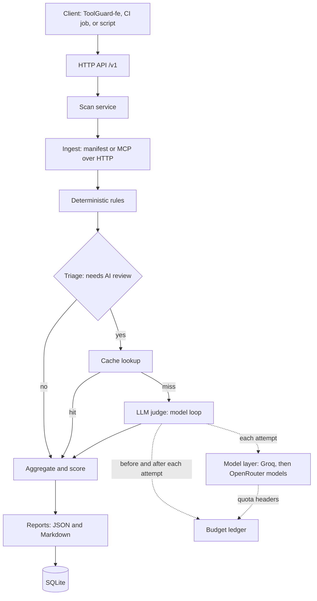

# ToolGuard: Architecture

Status: Draft v0.1
Companion documents: prd.md, sdd.md, pdd.md

## 1. Architectural Principles

1. Deterministic first, AI second. Rules and deterministic suspicion signals do most of the work. The language model only judges what remains suspicious or ambiguous.
2. One narrow model layer. All model calls go through a single module, so providers and model names can change without touching the rest of the code.
3. Untrusted input stays data. Scanned text is never executed and never followed as instructions.
4. Degrade, never fail. If AI quota is exhausted, the scan still completes with a flag saying AI review was skipped.
5. Keep it simple. A single FastAPI service, SQLite storage, and plain Python functions for pipeline stages. Pydantic AI is used where it adds value: the judge agent, provider models, structured output, and testing.
6. API first. The versioned HTTP API is the only interface of the product. The separate frontend (ToolGuard-fe), CI jobs, and scripts are all clients of it.

## 2. System Overview



## 3. Components

### 3.1 API layer (FastAPI)
Thin HTTP layer and the only interface of the product. It validates requests, creates a scan record, hands the work to the scan service, and returns results. It contains no detection logic.

Planned endpoints, all under /v1 (details in sdd.md section 18):
- Submit a scan (manifest body or server URL, optional fail_on threshold, AI review on or off), returns a scan ID.
- List scan history.
- Get scan detail and progress (status plus current stage).
- List findings and per-tool results, with pagination, filtering by severity and category, and sorting.
- Get the report in JSON or Markdown form.
- Get remaining AI budget per provider.
- Health check.

### 3.2 Frontend readiness
The API is designed so the separate frontend (ToolGuard-fe) can attach without backend rework:
- Versioned paths under /v1 with a stable OpenAPI schema generated from typed models. Changes within v1 are additive only.
- CORS allowed origins come from a setting and are off by default.
- Progress is polled first. The status response is shaped so a streaming endpoint can later emit the same stage objects without breaking clients.
- One error shape with stable machine-readable codes on every route.
- An optional service access token. Real user accounts are out of scope.
- CI pipelines use the same API: they submit a scan with a fail_on threshold and read the verdict, counts, and degraded flag from the response.

### 3.3 Scan service (pipeline orchestration)
A plain Python module that runs the stages in order and records results. Stages are ordinary functions that take and return typed models. This is deliberately not a multi-agent system, and it does not need a graph framework.

Stages:
1. Ingest and normalize.
2. Deterministic rules.
3. Triage: decide which tools need AI review.
4. Cache lookup, then judge for the misses.
5. Aggregate findings, compute severity and verdict.
6. Render reports and persist.

### 3.4 Ingestion
- Manifest ingestion: parse a JSON tool list into the internal tool model. Accepts a bare tool array, an MCP tools/list result, or a full JSON-RPC response, so a server's real output can be pasted directly.
- Remote ingestion: connect to an MCP server over HTTP using the official MCP Python SDK, list its tools, and normalize them. Guard against private network addresses, large responses, long redirects, and timeouts.
- The MVP does not launch local stdio servers, because that would execute untrusted code. A sandboxed approach is a later feature.

### 3.5 Rule engine
A registry of small rule objects. Each rule inspects a normalized tool and returns zero or more findings with an ID, severity, category, evidence span, and explanation. Rules are grouped in modules by category: injection phrasing, hidden characters, exfiltration signals, cross-tool manipulation, schema weakness, naming risks, and size or structure anomalies. Adding a rule means adding one rule object and its fixtures.

### 3.6 Classifier stage (removed)
A Groq-hosted prompt-injection classifier was evaluated in M0 and removed from the MVP. It detected classic jailbreak phrasing (0.9996) but not realistic tool-poisoning descriptions (0.0023 and 0.0027, close to a benign 0.0004), it is a preview model, and it rejects input over 512 tokens. See spikes/FINDINGS.md and sdd.md section 7.

### 3.7 Triage
A pure function with no model calls that decides which tools go to the judge. A tool whose rule findings already reach the fail threshold is skipped, since AI review cannot change the verdict. A tool with any other rule finding, or with a deterministic suspicion signal (risky capability hints, markup-like or directive-like text, long description), is reviewed. A clean tool is skipped. Reviewed tools are ordered by suspicion so the most suspicious ones fit within the per-scan cap. Details in sdd.md section 8.

### 3.8 LLM judge (Pydantic AI)
A single Pydantic AI agent with no tools and a fixed structured output type. It receives a batch of flagged tools, each inside clearly delimited data blocks, along with the deterministic findings already found, and returns validated structured findings and per-tool verdicts.

Rules for the judge:
- It can add findings, raise severity, and explain.
- It cannot remove or downgrade a deterministic high or critical finding. It may only annotate it as a likely false positive for human review.
- Its prompt states that the content is untrusted data and must not be followed.
- Its prompt defines each severity level, and a tool with no risk signals is info.
- It uses Pydantic AI tool output mode, with risk_level restricted to the severity values.
- Temperature 0, the lowest reasoning effort each model allows, and an output limit that leaves room for reasoning plus the answer.
- It loops over the model list itself (section 3.9): on a provider error or on invalid output after one validation retry, it moves to the next model.
- The prompt has a version string that is part of the cache key.

### 3.9 Model layer
The only place that knows about providers.

- Builds an ordered model list: Groq GPT-OSS model first, then OpenRouter's free Nemotron model, then OpenRouter's free Gemma model. Model names come from configuration.
- Does not use Pydantic AI's FallbackModel. FallbackModel only falls back on provider errors, not on output validation failures, and has no hook for the budget ledger. The judge loops over the list instead (section 3.8, sdd.md section 11.7).
- Per-model settings, since each provider has different optimal settings. Provider client retries are set to zero so the ledger sees every real call.
- Reads Groq quota headers on every response through an HTTP client hook and passes them to the budget ledger.
- Concurrency and request-rate limiting so calls stay under per-minute limits (30 per minute on Groq, 20 per minute on OpenRouter free models, as of October 2026 documentation).
- Both providers are supported natively by Pydantic AI, so no custom adapters are needed.

### 3.10 Budget ledger
Persisted in SQLite and consulted by the judge before and after each model attempt. When a provider cannot take a call, the judge skips it. When none can, the scan service marks the result as degraded and continues without AI review.
- Groq: quota behaves as a continuously refilling bucket (observed in M0: one request refills every 86.4 seconds at 1,000 per day). The ledger is driven by the rate limit headers on every response, with its own counters for the limits the headers do not report (requests per minute, tokens per day) and for restarts.
- OpenRouter: our own call count is the source of truth. The account's free_model_daily_requests figure lags by a few minutes and is used only as a cross-check (the larger of the two wins). The free daily counter is treated as one pool shared by all free models until proven otherwise, so listing several free models adds resilience, not quota.
- Token estimates are input plus the full output limit, because reasoning counts as output.

### 3.11 Cache
Keyed by a hash of the normalized tool content and the judge prompt version. A hit returns the stored verdict without any AI call. This also makes rescans cheap and enables later change detection.

### 3.12 Aggregation and scoring
Merges findings from rules and the judge, removes duplicates, assigns an overall severity and verdict, and records which stage produced each finding. Scoring is deterministic and documented so results are reproducible.

### 3.13 Reporting
Renders the scan result to JSON and Markdown. All scanned text shown in reports is escaped or neutralized so it cannot affect a person or tool viewing the report.

### 3.14 Storage
SQLite for the MVP: scans, tools, findings, cache entries, the AI call log, and provider quota snapshots. This is simple and enough for a single instance. Postgres is a later change if multiple instances or users are needed.

### 3.15 Observability
Structured logs for each stage with timings and AI usage. Pydantic AI emits OpenTelemetry spans, so a tracing backend can be added later without code changes to the pipeline. Whether to adopt a hosted free tier is an open question.

## 4. Data Model (conceptual)

| Entity | Key fields |
|---|---|
| Tool | server name, tool name, title, description, input schema, input schema missing flag, annotations, content hash |
| Finding | ID, source (rule or judge), rule ID, category, severity, tool name, evidence text and position, explanation, confidence, review note |
| Judge verdict | tool name, verdict, added findings, severity adjustments, false positive notes |
| Scan | ID, target, status, current stage, fail_on threshold, timestamps, tool count, overall severity, verdict, AI review status and reason, degraded flag, AI usage summary |
| Cache entry | content hash, prompt version, verdict, created time |
| AI call | provider, model, time, estimated tokens, actual input and output tokens, outcome |
| Provider quota | provider, latest rate limit header values and when they were observed, cooldown, reported daily usage for cross-checks |

Severity levels: info, low, medium, high, critical.

Finding categories: tool poisoning or injection, data exfiltration, hidden characters, cross-tool manipulation, excessive permissions or weak schema, naming and impersonation, structural anomalies.

## 5. Scan Flow in Detail

1. A client submits a manifest or a server URL.
2. The service creates a scan record with status pending.
3. Ingestion produces normalized tools, or fails with a clear error.
4. The rule engine runs on every tool. Cost: no AI calls.
5. Triage selects tools for AI review and orders them by suspicion within the per-scan cap.
6. For each selected tool, the cache is checked. Misses are batched into as few judge calls as the token budget allows.
7. For each batch, the judge asks the budget ledger whether Groq can take the call, then calls it. On a provider error, or invalid output after one validation retry, it moves to the next model in the list. The ledger is updated after every attempt.
8. Judge results are validated, merged under the rules in section 3.8, and cached.
9. If no model is available or budget is exhausted, the result is marked degraded and the scan continues.
10. Findings are aggregated, scored, rendered, and stored.
11. The client polls the scan until it is completed or failed, then fetches findings or the report. A CI client decides pass or fail from the verdict.

Processing in the MVP runs in-process using a simple asynchronous task, so the API returns quickly and the client polls for status and current stage.

If no provider keys are configured, or the request turns AI review off, steps 5 to 9 are skipped and the scan reports AI review as disabled. A disabled scan is not degraded.

## 6. Proposed Project Structure

```
ToolGuard-be/
  pyproject.toml
  .env                  (ignored by git)
  .env.example
  README.md
  prd.md  architecture.md  sdd.md  pdd.md  instruction.md
  src/toolguard/
    main.py             FastAPI app creation
    config.py           settings from environment
    api/                routes and request/response schemas
    core/               typed models, pipeline, triage, scoring
    ingest/             manifest parsing, MCP HTTP client, URL safety
    rules/              rule registry and rule modules by category
    llm/                model layer, judge, budget ledger, cache
    storage/            SQLite access
    reporting/          JSON and Markdown renderers
  tests/
    fixtures/
      benign/           known-good tool manifests
      malicious/        known-bad manifests with expected findings
    unit/               one test module per rule group and per stage
    integration/        full pipeline runs and API contract tests using a fake model
  spikes/               M0 verification scripts (run manually) and FINDINGS.md
```

## 7. Testing Strategy

- Unit tests for every rule using small fixtures, with no AI involved.
- Pipeline tests using Pydantic AI's offline test model or a function-based fake model, so tests never spend real quota.
- A fixture corpus of benign and malicious manifests with expected outcomes, run through pytest. This is the regression harness and also the CI gate for the project itself. It reports detection and false positive rates.
- API contract tests, including a committed OpenAPI schema snapshot so unintended contract changes fail the build.
- Recorded model responses for judge behavior tests, so they are repeatable.
- A single manual smoke test against the real providers, run rarely, to confirm structured output, the judge's model loop, and the Groq quota headers.
- Later: use Pydantic Evals with deterministic evaluators to measure detection quality over time, avoiding evaluators that consume LLM calls.

## 8. Security Design

- Treat every tool name, description, and schema as hostile input.
- The judge has no tools and cannot take actions. Its output is validated against a strict schema.
- Deterministic findings are ground truth that the LLM cannot erase.
- Remote ingestion blocks private and internal address ranges, limits redirects, response size, and time, and does not follow credentials or secrets from scanned content.
- No execution of scanned servers' tools. The scanner only lists tools.
- Reports neutralize scanned text.
- API keys come from environment variables, are never logged, and are never placed in reports or error messages.
- Rate limiting and size limits on the scanner's own API when deployed.

## 9. Deployment Considerations

- Package as a container with configuration from environment variables.
- The MVP is single-instance because of SQLite and in-process budget counters. Running multiple instances would require moving both to a shared store.
- Provide a health endpoint and a budget endpoint for operations.
- The free-tier model limits are shared per account, so deployment should not multiply request volume without a plan.
- Provider data policies should be reviewed before any use beyond personal development.

## 10. Key Decisions and Alternatives Considered

| Decision | Choice | Alternatives and reasons not chosen |
|---|---|---|
| Agent framework | Pydantic AI | LangGraph is more orchestration than a pipeline needs; OpenAI Agents SDK favors OpenAI's platform; AutoGen is reported to be in maintenance mode |
| Pipeline style | Plain functions in a fixed order | A graph or multi-agent system adds complexity without benefit here |
| Interface | HTTP API only, consumed by a separate frontend | A CLI was dropped: CI is served by the API response, and one interface keeps the contract in one place |
| Progress | Polling first | Streaming can be added later as an extra endpoint emitting the same stage objects |
| Primary provider | Groq free tier | OpenRouter free allows only 50 calls per day without credits |
| Fallback | OpenRouter free models | Adds resilience, though quota is shared at account level |
| Model switching | The judge loops over the model list itself | Pydantic AI's FallbackModel does not fall back on invalid output (confirmed in M0) and has no hook for the budget ledger |
| Structured output | Pydantic AI tool output mode | Native output depends on per-provider schema support; prompted output used about 25 to 40 percent more input tokens in M0 |
| Classifier stage | Removed from the MVP | Llama Prompt Guard 2 missed realistic tool poisoning in M0 (0.0023 and 0.0027), is a preview model, and has a 512 token limit; deterministic suspicion signals order triage instead |
| Groq quota tracking | Driven by rate limit headers on every response | Fixed daily counters do not match Groq's continuously refilling quota observed in M0 |
| OpenRouter quota tracking | Our own count, cross-checked against the account counter | The account's free-model counter lagged by a few minutes in M0 |
| Storage | SQLite | Postgres is better for scale but unnecessary for the MVP |
| Server execution | No stdio execution in MVP | Running untrusted servers needs sandboxing, deferred to a later version |
| Judge authority | Can add and raise, cannot erase rule findings | Letting the LLM override rules would make the scanner manipulable |

## 11. Open Technical Questions

Questions about output mode, the classifier, Groq quota behavior, and validation-failure fallback were answered in M0 (see section 10 and spikes/FINDINGS.md). Still open:

1. Whether OpenRouter's free daily counter is shared across all free models, and when it resets.
2. Calibration of judge token estimates on the real fixture corpus (M5).
3. Which MCP HTTP transports and authentication schemes to support first.
4. Whether to adopt hosted tracing or rely on structured logs initially.